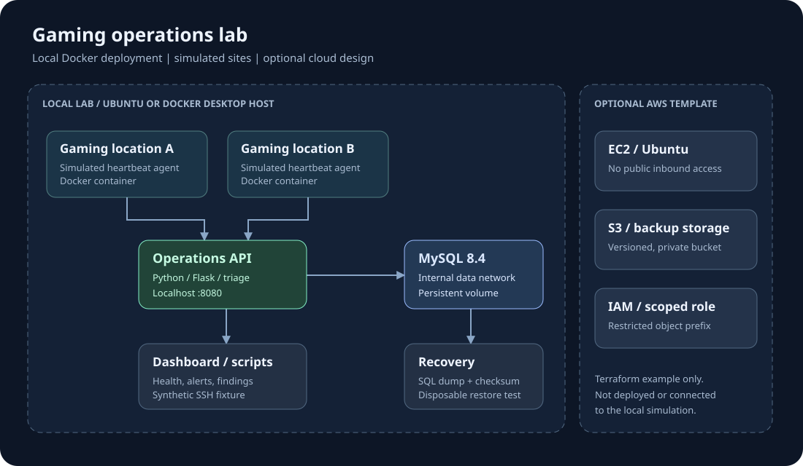

# Gaming Infrastructure & Security Operations Lab

A personal systems administration project for a small, multi-location gaming business.

The idea behind this lab is simple. If a game location depends on a server, database and network connection to stay open, IT needs to know when something breaks and have a plan to get it working again. I wanted a setup that brings Linux, containers, database administration, monitoring, security and recovery together rather than treating them as separate exercises.

This is a simulated environment using synthetic data. It is not connected to Activate Games, any employer, or a real gaming facility. The code is ready to run locally; the AWS configuration is optional. No production infrastructure, live security incidents or cloud deployments are claimed.

## What the lab covers

| Area | Implementation |
| --- | --- |
| Server administration | Ubuntu host setup guide, container deployment, service and patch checks |
| Store operations | Two simulated gaming locations sending health updates to a central service |
| Docker | Compose orchestration, persistent storage, service isolation and restart procedures |
| MySQL | Application accounts, persistent data, logical backup and disposable restore verification |
| Monitoring | Local operations dashboard, heartbeats, offline detection, and a documented Zabbix integration path |
| Security | Failed SSH login detection, alert triage, severity assessment and documented containment decisions |
| Vulnerability management | Trivy scan instructions and a finding tracker with remediation and verification notes |
| AWS | Optional Terraform example with EC2, S3, scoped IAM and no public inbound access |
| Automation | Python scripts for lab setup, backup, recovery checks and incident fixtures |

## Architecture



The two locations are simulated services, not two physical Ubuntu servers. The dashboard and MySQL run in the local Docker environment. The actual Ubuntu host and optional AWS resources are separate from the simulation. The dashboard binds to localhost. Do not expose this demo to the public internet.

## Getting started

Requirements: Docker Desktop or Docker Engine with Compose v2, and Python 3.10 or newer. Open Docker Desktop before running the commands if you are on Windows.

From the root of the GitHub repository:

```bash
cd gaming-infrastructure-lab
python tools/lab.py init
docker compose up -d --build --wait
```

Open **http://127.0.0.1:8080**. No cloud account is needed.

The init command creates local random database credentials in a gitignored .env file. It will not replace an existing file. MySQL uses a dedicated application user. Only the dashboard is published to the host.

## Demo walkthrough

1. Open the dashboard and check that both sites are online.
2. Run `python tools/lab.py demo` to process the sample SSH log and add a sample vulnerability finding.
3. Triage the alert. Add a severity assessment and note the containment action you would take.
4. Record a remediation and verification note for the sample finding.
5. Run `docker compose stop site-b`. After about 25 seconds the second location should show offline.
6. Run `docker compose start site-b` and check that its heartbeat returns.
7. Run `python tools/lab.py backup`. Copy the backup path it prints.
8. Run `python tools/lab.py restore-check backups/<filename>.sql` to restore into a disposable database and compare table counts. Do not change records while running the comparison.

The sample alert and vulnerability are intentionally simulated. Marking a record as closed in the dashboard is not the same as containing a real incident or installing a patch.

## Testing

```bash
python -m unittest discover -s tests -v
python tools/smoke.py
```

The first command tests the SSH detection logic without Docker. The second requires the running lab and checks the API, both heartbeats, alert triage, finding verification and an actual MySQL dump/restore. GitHub Actions runs these checks as well. See the [Actions tab](https://github.com/stefan-okafor/cybersecurity-analysis-tool/actions) for the actual result, rather than assuming a test has passed.

## Documentation

- [Ubuntu setup and daily operations](docs/operations.md)
- [Security incident and vulnerability workflow](docs/security.md)
- [Backup, restore and disaster recovery](docs/recovery.md)
- [Optional AWS setup](aws/README.md)
- [Demo and evidence checklist](docs/demo.md)

## Current scope

The local lab has a real MySQL-backed dashboard and two simulated locations. The Ubuntu setup guide, Zabbix/Wazuh integration notes and Terraform configuration are implementation guides, not evidence of a deployed enterprise environment. I would use the evidence checklist to record actual results when running the lab.

To stop the environment without deleting its database:

```bash
docker compose down
```

Avoid `docker compose down -v` unless you deliberately want to erase the lab database. Backups remain in the local backups directory.
